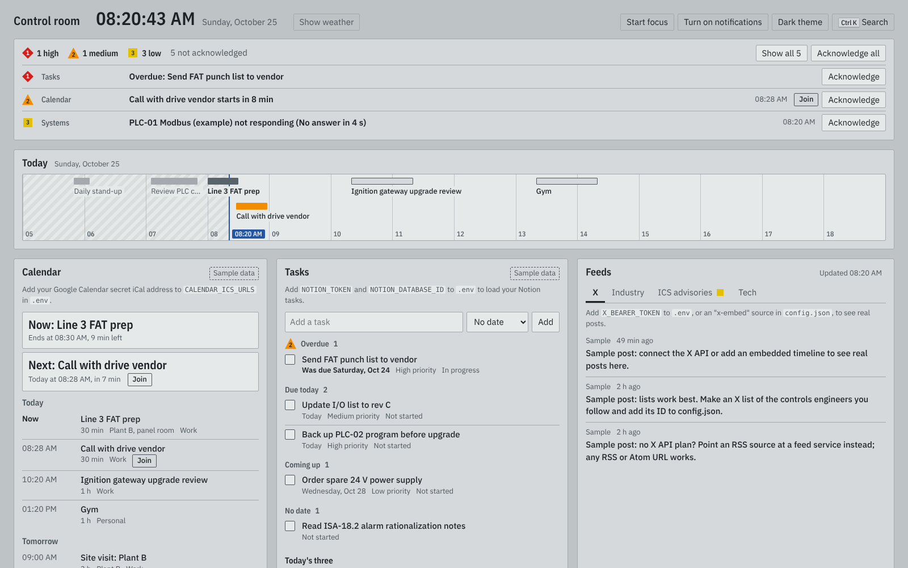

# Control room

One screen for the working day: your Google Calendar, Notion tasks, X and industry
feeds, the systems you look after, and the tabs you open every morning. It is laid out
like a high-performance HMI (ISA-101): everything is gray while it's normal, and colour
only shows up when something needs you.



## Start it

Needs Node.js 20.12 or newer.

```bash
cd control-room
npm install
npm start            # http://127.0.0.1:4300
```

It runs with sample data straight away. Each panel tells you what to add to connect
your own account; nothing is required.

```bash
cp .env.example .env                  # secrets: calendar URLs, Notion token, X token
cp config.example.json config.json    # everything else: tabs, feeds, systems, alarms
```

Restart `npm start` after editing either file. Both are git-ignored, so your keys and
plant addresses stay on your machine.

## What's on the screen

| Panel | What it does |
|---|---|
| Alarm banner | Everything that needs attention, by priority. Acknowledge one at a time or all at once. |
| Today | Your day as a trend: past events hatched, the running one dark, the next one amber when it's about to start, and a cursor at the current time. |
| Calendar | What's on now, what's next with a countdown and a Join button, and the next 7 days. |
| Tasks | Open tasks from a Notion database, grouped by due date. Add tasks and mark them done without leaving the page. |
| Today's three, Notes | Your top three for the day and a scratchpad, saved in `data/notes.json`. Unfinished items roll over to tomorrow. |
| Feeds | Tabs of X posts and RSS feeds. The ICS advisories tab watches CISA for vendors you name. |
| Systems | Reachability checks for web services, SCADA gateways and PLC ports. |
| Work tabs | Your usual links in groups, with "Open all" to start a working session in one click. |

Keyboard: `Ctrl K` (or `/`) opens search across links, tasks, events and actions such as
starting a focus block or opening a group of tabs.

## Alarms

Alarms follow ISA-18.2 habits: few of them, each one actionable, and every colour also
has its own shape.

| Shape | Priority | Raised when |
|---|---|---|
| Red diamond, 1 | High | A system marked `"critical": true` is down, or a high-priority task is overdue |
| Amber triangle, 2 | Medium | A meeting starts within `meetingLeadMinutes`, or a task is overdue |
| Yellow square, 3 | Low | A non-critical system is down, or new advisories mention a watched vendor |
| Magenta circle, ? | Data source | A calendar, Notion or feed can't be reached; the panel keeps showing its last good data |

Advisories for the same vendor are grouped into one alarm, so a vendor's monthly patch
day doesn't flood the banner. An acknowledged alarm stays acknowledged until its
condition clears; if it comes back, it alarms again. Turn on notifications to get
high and medium alarms as desktop notifications.

## Use it from any browser (Vercel)

The dashboard can also run on Vercel, so it opens in any Chrome tab or on your phone
without `npm start`. The hosted copy asks for a password (`APP_PASSWORD`) before it
shows any data; without one set it refuses to serve anything.

Set these in the Vercel project under **Settings > Environment Variables**, then redeploy:

| Variable | What it holds |
|---|---|
| `APP_PASSWORD` | The sign-in password (required) |
| `CALENDAR_ICS_URLS`, `NOTION_TOKEN`, `NOTION_DATABASE_ID`, `X_BEARER_TOKEN` | Same as in `.env` |
| `CONFIG_JSON` | Optional: the whole contents of your `config.json`, so your own tabs, feeds and systems are used |

Differences from running it locally:
- Today's three and Notes are saved in your browser, so they don't follow you between devices.
- Checks of `localhost`, `.local` and private addresses (192.168.x.x, 10.x.x.x, 172.16-31.x.x)
  are skipped, because Vercel's servers can't reach your plant or home network. Run it
  locally for PLC and gateway checks.

## Connect your accounts

### Google Calendar

1. Open Google Calendar settings, pick the calendar, and find **Integrate calendar**.
2. Copy **Secret address in iCal format**.
3. Put it in `.env`; separate several calendars with `;` and optionally name them:

```bash
CALENDAR_ICS_URLS="Work=https://calendar.google.com/calendar/ical/.../basic.ics; Personal=https://..."
```

This reads your calendar without a Google Cloud project. Treat the secret address like
a password. Outlook and Apple calendars publish `.ics` links that work the same way.

### Notion

1. Create an internal integration at <https://www.notion.so/profile/integrations> and
   copy its token.
2. Open your tasks database, choose **...** > **Connections**, and add the integration.
3. Copy the 32-character ID from the database URL.

```bash
NOTION_TOKEN=ntn_...
NOTION_DATABASE_ID=0123456789abcdef0123456789abcdef
```

The app finds the title, status (or a "Done" checkbox), due date and priority
properties by itself. If your names are unusual, set them under `notion` in
`config.json`, along with `doneValue` (the status that means finished, `Done` by
default).

### X (Twitter)

Reading posts through the X API needs a paid API plan. Choose what fits:

- **X API:** put your bearer token in `X_BEARER_TOKEN` and use sources like
  `{ "type": "x", "user": "handle" }` or `{ "type": "x", "list": "1234567890" }`.
  A list of the accounts you care about works best.
- **Embedded timeline:** `{ "type": "x-embed", "url": "https://x.com/handle" }` shows
  X's own widget, no token needed. Whether it loads depends on X and on being signed in
  to X in that browser.
- **RSS:** any service that turns an account into an RSS feed works as a normal
  `{ "type": "rss", "url": "..." }` source.

## config.json reference

```jsonc
{
  "title": "Control room",
  "dayWindow": { "start": 7, "end": 19 },       // hours the Today trend always shows
  "agendaDays": 7,
  "alarms": { "meetingLeadMinutes": 10, "advisoryDays": 7 },
  "weather": { "latitude": 52.52, "longitude": 13.41, "label": "Berlin" },  // or null to use the browser's location
  "feeds": [
    { "name": "ICS advisories", "sources": [
      { "type": "rss", "url": "https://www.cisa.gov/cybersecurity-advisories/ics-advisories.xml",
        "label": "CISA", "watch": ["Siemens", "Rockwell"] }
    ] }
  ],
  "systems": [
    { "name": "Ignition gateway", "type": "http", "url": "http://10.0.0.5:8088/StatusPing", "critical": true },
    { "name": "PLC-01", "type": "tcp", "host": "192.168.1.10", "port": 44818 }  // EtherNet/IP
  ],
  "launchpad": [
    { "name": "Daily", "links": [{ "label": "Gmail", "url": "https://mail.google.com" }] }
  ]
}
```

System checks run from the machine where `npm start` runs, so PLC and gateway checks
only work on a computer that can reach the plant network. HTTP checks count any answer
below 500 as up; add `"expectStatus": 200` to be strict. Common TCP ports: Modbus 502,
EtherNet/IP 44818, S7 102, OPC UA 4840.

"Open all" opens one browser tab per link. Browsers block all but the first unless you
allow pop-ups for `127.0.0.1:4300`.

## Security

The server listens on `127.0.0.1` only, because it holds your tokens and can write to
Notion. Don't set `HOST=0.0.0.0` on a shared network. Text from feeds and calendars is
escaped before it's shown, and only `http` and `https` links are rendered.

## Develop

```bash
npm run dev    # restarts on file changes
npm test       # parsers, alarm rules, trend layout, cache, notes
```

`server/` holds one small module per data source. `public/` is plain HTML, CSS and ES
modules with no build step; `public/js/alarms.js` holds the alarm rules.
