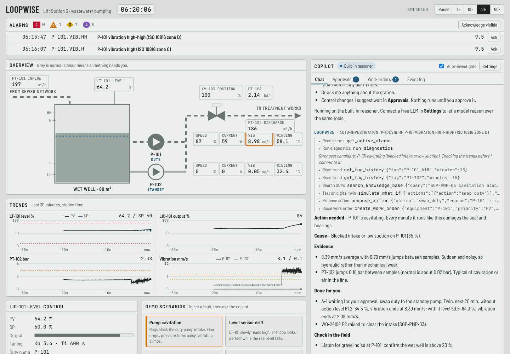

# Loopwise: an AI copilot for the control room

Loopwise watches an industrial process, works out what is wrong, tests a fix on a digital twin and
hands the operator a ready-to-approve action. It never changes the plant by itself.

The demo runs **Lift Station 3**, a simulated wastewater pumping station: a 60 m³ wet well, two VFD
pumps (duty/standby), a discharge valve and a level PI loop (LIC-101). Everything runs in the browser,
so it costs nothing to host or show.



## What it shows

| Area | What the copilot does |
|---|---|
| **Monitoring** | 16 live tags, ISA-101 grey HMI where colour appears only for abnormal states, 30-minute trends |
| **Alarm management** | ISA-18.2 style: four priorities, on-delays, deadbands, acknowledge, return-to-normal |
| **Root cause** | Analytics checks (loop oscillation, mass balance, pump curve, pressure jitter, valve tracking) feed a rule engine; the agent verifies against trends and SOPs |
| **Early warning** | Catches a drifting level transmitter from the flow balance **before any alarm fires** |
| **Predictive maintenance** | Vibration and temperature trends with time-to-ISO-10816-zone-D forecasts |
| **Control engineering** | Detects a hunting loop and computes SIMC PI tuning from the station model |
| **Digital twin** | `simulate_what_if` runs the station forward with and without an action and compares the outcome |
| **Human in the loop** | Proposals go to **Approvals** with guardrails (range limits, interlocks); field work goes to **Work orders** |
| **Reporting** | One-click shift handover report |

## Demo script (5 minutes)

1. **Pump cavitation** – the vibration alarm trips; the copilot investigates by itself, proposes a duty swap
   (tested on the twin) and raises a work order. Approve the swap and watch vibration drop.
2. **Level sensor drift** – no alarm at all. The copilot notices the level disagrees with the flows,
   estimates the real level and warns that the pumps are heading for dry-run.
3. **Loop retuned badly** – the pumps hunt. Ask *"Check LIC-101 tuning"*: it shows the SIMC maths,
   proves the new tuning on the twin and queues it for approval.
4. **Stuck discharge valve** – the copilot explains why starting the second pump will *not* help.
5. **Write the shift report** – a handover note from everything that happened.

Use **Work orders → Mark completed in the field** to play the technician who fixes the fault.

## Run it

It's static HTML, CSS and JavaScript with no build step:

```bash
cd loopwise
python3 -m http.server 8080      # open http://localhost:8080
```

Opening `index.html` directly also works for the built-in reasoner.

## Connect a free LLM

The **built-in reasoner** needs no key: it calls the same tools with fixed expert rules, so a demo never
depends on an internet connection. To let a model reason freely, open **Settings**:

| Brain | Free tier | Default model |
|---|---|---|
| Groq | ~1,000 requests/day, fast | `openai/gpt-oss-120b` |
| OpenRouter | 50 requests/day on `:free` models | `openrouter/free` |
| Google Gemini | free tier via the OpenAI-compatible endpoint | `gemini-flash-latest` |
| Ollama | runs on your own PC, unlimited | `qwen3:8b` (start Ollama with `OLLAMA_ORIGINS=*`) |

Any OpenAI-compatible endpoint with tool calling works. The key is stored only in your browser. If a call
fails, the copilot says so and answers with the built-in reasoner. One investigation uses about 6–10 requests,
and auto-investigation waits 60 s between runs when an LLM is connected.

## Put it on the web (free)

- **GitHub Pages:** copy the `loopwise/` folder to a `gh-pages` branch (or enable Pages on a repo that holds it).
- **Netlify Drop:** drag the `loopwise` folder onto https://app.netlify.com/drop.
- **Cloudflare Pages / Vercel:** set the root directory to `loopwise`, no build command.

## How it works

```
js/sim.js     plant model: wet well mass balance, pump curves, VFD ramps, PI loop, faults
js/detect.js  history buffer, alarm engine, diagnostic checks, rule engine, SIMC tuning
js/kb.js      site knowledge base (SOPs, equipment data, ISO 10816, alarm philosophy)
js/tools.js   the agent's 9 tools; read-only except propose_action and create_work_order
js/agent.js   LLM tool-calling loop + built-in reasoner
js/app.js     HMI, trends, faceplate, copilot console
```

The agent can read anything, but it can only *propose* control changes. `propose_action` dry-runs each
proposal through the same command layer the operator uses, so out-of-range setpoints or an interlock
(stopping the duty pump) are rejected before they reach the operator.

## Tests

```bash
node --test loopwise/test/*.test.js
```

14 tests: no false positives over 3 healthy hours, the right cause for each of the six scenarios,
drift caught before any alarm, SIMC tuning stopping the oscillation on the twin, approval guardrails,
and the LLM loop against a mocked API.

See [BUSINESS.md](BUSINESS.md) for who buys this and how to sell it.
